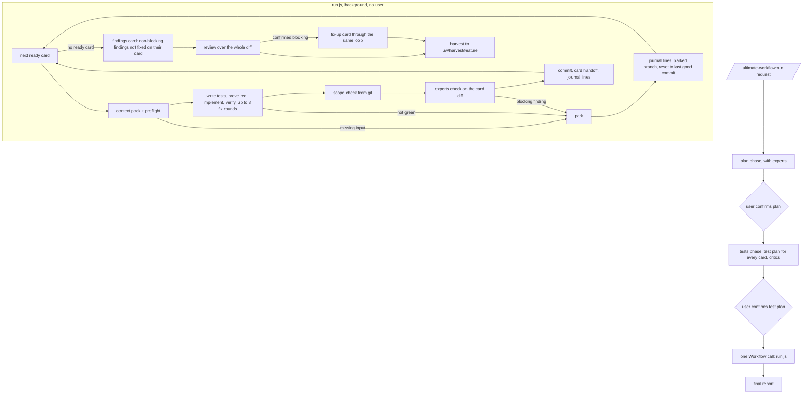

# PLAN: autopilot run (draft proposal, not confirmed)

> Draft. No gate state on purpose: this file must not steer the gates. Written 2026-11-07 against
> plugin 4.6.2 (8160e01). Target release: 4.7.0.
>
> Source evidence: the `/ultimate-workflow:value` report of the homeyos AWS-phase session (main
> conversations 2,127.1M tokens, 88.8% of the total, cacheShare 0.975; experts check 118M; build 82M;
> 8 catches, 7 open, no review in the ledger), and the design discussion of 2026-11-07.
> Related: `internal/plans/PLAN-run-records.md` (cards, G3 deferral on `background_tasks`),
> `commands/feature.md`, `phases/build.js`, `experts/cards.js`, `experts/ledger.js`, `experts/usage.js`,
> `skills/the-ultimate-workflow-guidelines/references/memory-protocol.md`.

## Goal

The user confirms the plan and the test plan once, then the whole plan runs to completion with no
further action from them: every card built, verified, expert-checked and committed; review and harvest
at the end; one final report. Nothing stops for the user after the second confirmation.

Success criteria:

1. After the test-plan confirmation the main conversation makes one call and receives one result. Its
   size does not grow with the number of cards (measured by `experts.js usage`: main conversation tokens
   for an N-card run within 1.5x of a 1-card run).
2. Every card's agents get the context they need (plan, test plan, cited docs, project memory, the
   earlier cards' handoffs, the run journal) by path, checked in code before the card starts.
3. A card that cannot be finished is parked on a named branch with its diagnosis and failing tests, and
   the run continues with the cards that do not depend on it.
4. Lessons found in card K reach cards K+1..N within the same run, through the run journal.
5. Harvest never stops the run; its proposals land on a review branch.
6. The value report after such a run shows the review and experts-check findings (bug 1) and finds the
   session even when it ran from a parent folder (bug 2).

Out of scope: Cursor and other hosts without the Workflow tool (they keep one card per session, see W8);
running cards in parallel; auto-accepting the test plan.

## Why: where the tokens go today

`commands/feature.md` (Full tier) runs `build.md` once per card, in order, in one main conversation.
Each phase agent already starts fresh with only its card's brief, which is why build plus the experts
check cost about 200M together. The main conversation is the cost: every tool output, plan display,
status check and result of every earlier card stays in it and is re-sent on every turn. By card 5 it
carries cards 1 to 4 for nothing. Cache reads are billed at about a tenth of input, so the dollar cost
is smaller than the token count, but it still dominates, and long context also slows and degrades the
model. It also stops at every confirmation and every escalation, which is the second complaint.

## Design

### Flow

### The two stops, and only two

The plan phase and the tests phase run as today. The tests phase drafts the test plan for every card in
one pass (one section per card, headed with the card name) so the user confirms it once. After the
second confirmation the command builds the run script and calls the Workflow tool once. It then reads
the final report from the output file and presents it. It does not poll and does not print per-card
progress into the conversation (progress is visible in `/workflows`).

### Per card, inside run.js

1. **Pick** the next card in plan order whose `depends` are all committed. A card with a parked
   dependency is skipped and reported as blocked by it.
2. **Context pack** (W2): written by code, read by the agents. Preflight fails the card (park, reason
   "missing input") when a doc the plan cites does not exist or the card has no test-plan section.
3. **Build loop**: the existing `phases/build.js` logic, inlined (a workflow cannot call another
   workflow): tests written and proven red, minimal implementation, verify, a fresh diagnoser per failed
   round, `ROUND_CAP = 3`.
4. **Scope**: `experts.js scope --card`, from git. Out-of-scope files are reported, not blocking (as now).
5. **Experts check** on the card's own diff (`prepare --range <last good>..`). A blocking finding parks
   the card; a non-blocking finding is carried to the first later card whose paths cover its file, or
   else, and also when that card did not fix it, goes to the findings card after the last plan card
   (Decision 2).
6. **Commit** by an agent with Bash, after the full suite is green, so G7 holds. Message: card name,
   title, and the plan file.
7. **Card handoff** (W2) and **journal lines** (W4), both written from the diff and the run's own
   results, never from what the build agent says it did (bug 5).

### Parked cards (W3)

A branch, not a stash. A stash is one shared positional stack, leaves new files out without `-u`, is
tied to no branch, and conflicts silently once commits sit on top. Instead:

- Commit the card's partial work, failing tests included, to `uw/parked/<feature>/<card>` with the
  diagnosis in the commit message and in `.ultimate-workflow/run/<feature>/cards/<card>/parked.md`.
- Reset the working branch to the last good card commit and continue.
- Record the branch and the reason on the card's entry in the plan's `## Cards` section
  (`parked: <branch>; <reason>`) and in the final report.
- Resume: `/ultimate-workflow:run --resume <card>` rebases the parked branch onto the current tip and
  continues at implement with the tests already written (`resumeAt: 'implement'`, which `build.js`
  already supports), with the diagnosis in the context pack. The user can also finish it by hand.

### Memory: three layers

| Layer | Where | Lifetime | Reaches cards how |
|---|---|---|---|
| Project memory | `AGENTS.md` Gotchas, `memory.md`, `memory/<topic>.md` in the target repo | permanent | context pack lists the Gotchas and every topical whose "Read when" cue matches the card's paths or title (chosen in code) |
| Run journal | `.ultimate-workflow/run/<feature>/journal.md` | this run only, not committed | every later card's context pack |
| Harvest proposals | branch `uw/harvest/<feature>`, one commit per destination file | until the user merges or drops it | the next run, once merged into project memory |

The journal is written after every card, committed or parked, by a fresh agent that reads that card's
diff, failures and fix rounds: what tripped it up, conventions found, decisions later cards must respect,
and why a card was parked. At most about 15 lines per card. It is never promoted to project memory
without the harvest branch being reviewed, so a wrong lesson cannot become permanent and nothing lands
in always-loaded text unseen.

Harvest at the end reads the journal, the whole diff and the plan, and commits its proposals to the
harvest branch instead of stopping for acceptance. The final report lists them.

## Work items

### S0. Spike: what the Workflow tool allows (before W1)

Verify, on Claude Code (Windows, `claude -p` and the desktop app), in a scratch repo:

- A workflow running 30+ minutes and 50+ agents completes, and its output file is readable.
- A workflow agent with Bash can `git commit`, `git branch`, `git reset` with the hooks active, and G7
  sees the full-suite verify record. Record the hook payloads into `fixtures/claude-code/workflow/`.
- The main session's Stop during the run is deferred by G3 on `background_tasks` (built in 4.2.x).
- Whether a workflow agent can read files the script itself cannot (the script gets paths; agents read).

**Fallback if a long single workflow is not reliable:** the command calls the Workflow tool once per
card with a per-card script and keeps only each card's one-line status in the conversation. The main
conversation then grows by a few hundred tokens per card instead of tens of thousands; criterion 1 is
relaxed to "under 5% of the run's tokens". Decide after S0.

### W1. `/ultimate-workflow:run` command and `phases/run.js`

- `commands/run.md`: plan, confirm, tests, confirm, build the script (`experts.js script --phase run`),
  create `uw/run/<feature>` from the current tip (Decision 1), one Workflow call, present the final
  report from the output file, record the ledger rows.
  `--resume <card>` and `--resume` (all parked or not started).
- `phases/run.js`: the card loop above. The build loop is shared with `build.js` (one source, a test
  holds them equal, like the agent names block) rather than copied by hand.
- `commands/feature.md`: the Full tier calls `run` when the Workflow tool is present.
- Requires a permission mode that does not prompt for edits (auto or accept-edits). The command checks
  and says so before the run instead of letting agents stall.

### W2. Context pack and card handoff

- `experts.js pack --plan <plan> --card <card> --feature <feature>` writes
  `.ultimate-workflow/run/<feature>/cards/<card>/context.md`: paths plus a one-line summary each, for the
  plan's shared sections (goal, decisions, constraints, contracts, interfaces), the card's section, the
  card's test-plan section, every doc path the plan cites, `AGENTS.md`, the matching memory topicals,
  the handoffs of the cards it depends on, the journal, the parked diagnosis when resuming, and the
  experts' briefs (`brief --card`, as now).
- Preflight in the same command: missing cited doc or missing test-plan section -> exit with a reason
  the script turns into a park.
- `experts.js handoff --card <card> --range <a>..<b>` writes `handoff.md` (about 10 lines: files changed,
  exported names and interfaces, decisions) from git, and lists claimed test files that are not in the
  diff (bug 5).
- `cards.js`: a `depends:` field (card names, comma separated) and a `parked:` field.

### W3. Parked branches

As in the design. `experts.js park --card <card> --feature <feature> --reason <file>` does the branch,
the commit, the reset and the plan entry, so the agent runs one command and no ad-hoc git.

### W4. Run journal

`experts.js journal add --feature <f> --card <c> --from <file>` appends, with a size check (about 15
lines per card, the whole file under about 200 lines; past that the oldest card entries are summarised
by the journal agent, never dropped silently).

### W5. Harvest to a branch

`phases/harvest.js` gets a `mode: 'branch'` argument: proposals are written and committed to
`uw/harvest/<feature>` (created from the run's last commit) and the result lists the commits. The
interactive `/ultimate-workflow:harvest` keeps proposing and stopping.

### W6. Ledger and usage fixes (bugs 1 to 3)

- Bug 1: review and experts-check findings are recorded in the value ledger (`ledger add` from the
  review and experts results), so `/value` shows catches by stage. run.js records every phase it runs.
- Bug 2: `usage --match` also matches sessions whose transcript folder is a parent of the project root
  and whose recorded `cwd` is inside it.
- Bug 3: reader agents (`uw-explorer`) are counted under "readers", not "other agents".

### W7. Windows and scanner fixes found in the same session

- The gate runs `test_command` through cmd on Windows, so a `bash -c '...'` command breaks on quoting:
  run it through the shell the plan names, or reject `bash -c` with a clear message.
- The secrets scanner that scanned `.ultimate-workflow/` is not in this plugin (no scanner in `hooks/`
  or `experts/`); it is the target project's. Fix on our side: `.ultimate-workflow/` is added to the
  project's `.gitignore` on first run, so git-based scanners skip it, and the docs say so.
- The tests phase no longer enters plan mode to show the plan, and never prints the plan into chat;
  it passes the path.
- An abandoned or re-run plan run is recorded in the ledger with `abandoned: true`.

### W8. Hosts without the Workflow tool

`run` says so and falls back to one card per session: after each card's commit it writes the handoff
and the journal lines and tells the user the next command (`/ultimate-workflow:build --card <next>`).
Documented in `rules/the-ultimate-workflow-guidelines.mdc` ("Running the phases here").

### W9. Lower the long-conversation reminder

Default `ULTIMATE_WORKFLOW_CONTEXT_REMINDER` from 150k to 80k tokens.

## Order and versions

S0 -> W2 -> W3 -> W4 -> W1 -> W5 -> W6 -> W7 -> W8 -> W9. W6, W7 and W9 are independent of the rest and
can land first as 4.6.3 if wanted. Everything else ships together as 4.7.0.

## Tests and acceptance

- Unit (`node:test`): `cards.js` parses `depends` and `parked`; `pack` lists exactly the expected paths
  for a fixture plan and fails preflight on a missing doc or test-plan section; `handoff` reports a
  claimed test file absent from the diff; `park` creates the branch, resets, and edits the plan entry in
  a temp git repo; `journal add` enforces its size rule; ready-card ordering with a parked dependency;
  `usage --match` finds a parent-folder session; ledger rows for review and experts findings.
- Script: `run.js` against a stub agent function (as the other phase scripts are tested): a 3-card plan
  where card 2 fails three rounds -> card 2 parked, card 3 (independent) committed, a card depending on
  card 2 reported blocked; review blocking finding -> one fix-up card; a non-blocking finding carried
  to card 3 and not fixed there, plus one with no matching card -> both in the findings card, which
  runs after card 3 and before review.
- End to end, once, recorded: a 4-card plan in a scratch repo through `/ultimate-workflow:run`, with
  `usage` before and after, to check criterion 1. Results in `evals/` like the other recorded runs.
- Full suite: `node --test ".cursor-plugin/ultimate-workflow/hooks/**/*.test.js" "evals/**/*.test.js" mirrors.test.js`.

## Risks

- A long workflow dies mid-run (machine sleep, host restart). Mitigation: every card ends in a commit or
  a parked branch, and the plan's Cards section is the state, so `--resume` continues from it.
- The run commits work the user has not seen. Mitigation: per-card commits on the working branch only,
  never a push; the final report lists every commit; parked and harvest work is on side branches.
- Auto-parking hides a systemic problem (every card fails the same way). Mitigation: two consecutive
  parks for the same reason stop the run with that reason.
- Context packs grow with the number of cards. Mitigation: only the handoffs of declared dependencies,
  plus the size-capped journal.
- Agents ignore the pack. Mitigation: the build agent's result must list the pack files it read; the
  scope check and the handoff are from git regardless.

## Decisions (owner, 2026-11-07)

1. **Working branch:** the run creates `uw/run/<feature>` from the current tip and commits every card
   there; the user merges it at the end. A bad run is one branch to drop, the user's own branch is never
   reset by a park, and the whole run reviews as one diff. Parked and harvest branches start from it.
2. **Non-blocking expert findings:** a finding whose file is under a later, not-yet-run card's `paths`
   becomes a `carried` item on the first such card (written with `card-add --carried`). Every other
   non-blocking finding, and every carried one the receiving card did not fix (its file still matches
   the finding after that card's commit, checked by re-running the finding's expert on that file), goes
   to one findings card after the last plan card: `findings` with `paths` set to the findings' files,
   run through the same loop (build, verify, experts check, commit, or park) before review. All of them
   are also in the ledger and the final report. Nothing is pushed onto a card that cannot touch the file,
   and nothing is left unfixed silently.
3. **Models:** every run role (implementer, diagnoser, journal agent, and the per-card experts check)
   uses the existing build model settings (`implementerModel`, `diagnoserModel`,
   `ULTIMATE_WORKFLOW_BUILD_MODEL`); no separate default for the journal agent.
